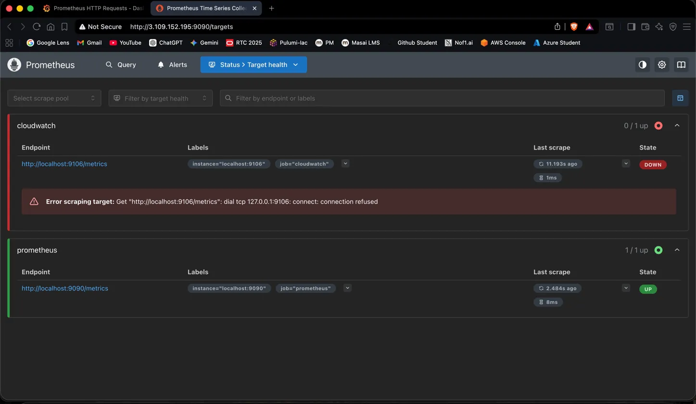
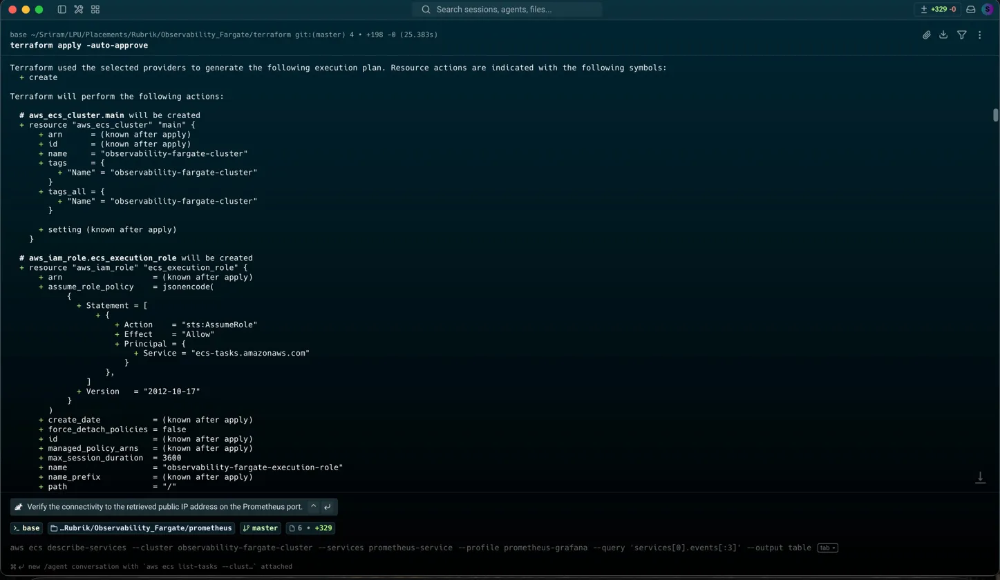
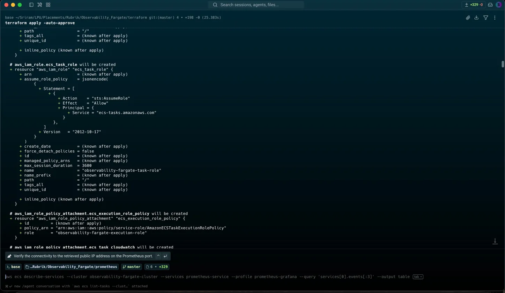
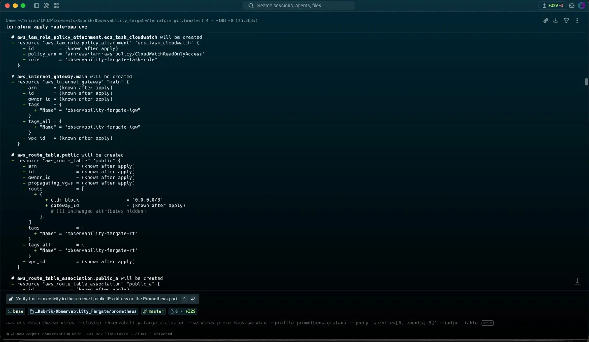
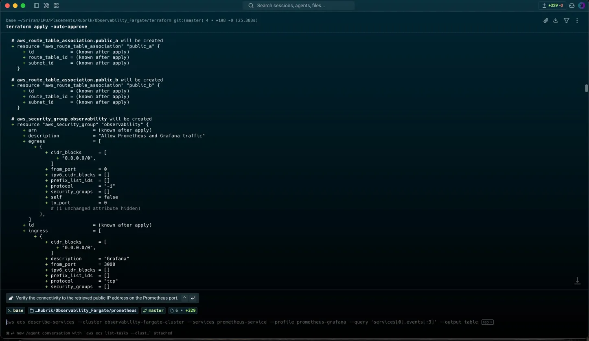
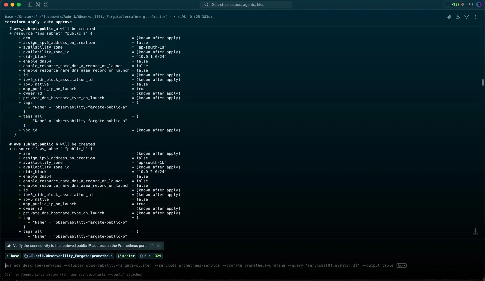
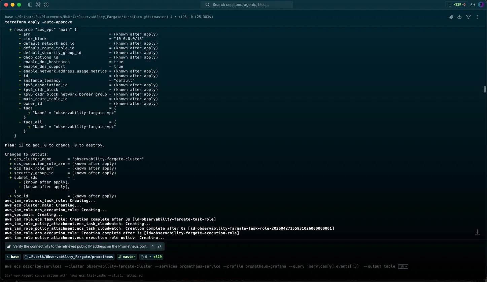
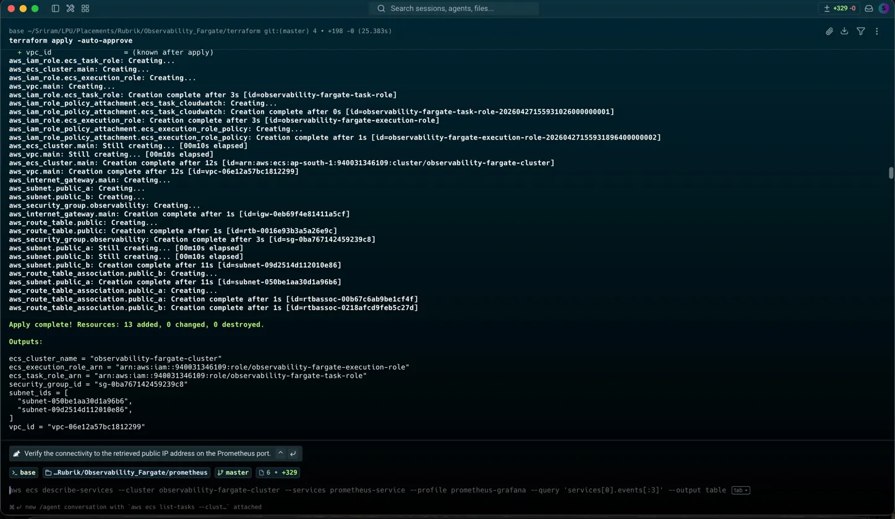

# Observability Stack on AWS ECS Fargate

A container observability pipeline deployed on **AWS ECS Fargate** using Terraform: Prometheus scrapes infrastructure metrics, Grafana visualizes them with real-time alerting. Built as a hands-on exercise in provisioning a monitoring stack on serverless containers — VPC, ECS, IAM, and CloudWatch logging, all via Terraform, with zero EC2 instances.

## Architecture
┌─────────────────────────────────────────────────────┐
│                    AWS (ap-south-1)                  │
│                                                      │
│  ┌─────────────┐         ┌─────────────────────┐    │
│  │  Prometheus  │────────▶│       Grafana        │   │
│  │ (ECS Fargate)│ scrapes │   (ECS Fargate)      │   │
│  │  port: 9090  │metrics  │    port: 3000        │   │
│  └──────┬───────┘         └──────────┬──────────┘   │
│         │                            │               │
│         ▼                            ▼               │
│   CloudWatch Logs            Alert Rules             │
│                           (severity: warning)        │
│                                                      │
│  ┌────────────────────────────────────────────────┐  │
│  │  VPC → Subnets → IGW → Security Groups → ECR  │  │
│  │           (Provisioned via Terraform)          │  │
│  └────────────────────────────────────────────────┘  │
└─────────────────────────────────────────────────────┘

## Stack

| Layer | Technology |
|---|---|
| Infrastructure | AWS ECS Fargate, VPC, ECR, CloudWatch |
| IaC | Terraform |
| Metrics | Prometheus (custom Docker image) |
| Visualization | Grafana |
| Alerting | Grafana Alert Rules |
| Container Registry | AWS ECR |

## Screenshots

### AWS ECS Cluster — Both Services Running


### Grafana Dashboard — Live Metrics


### Prometheus Targets — UP Status


### Grafana Alert Rule — High Request Rate


### Terraform Apply — Infrastructure Provisioning








## Features

- Containerized Prometheus + Grafana running on **ECS Fargate** (zero EC2)
- Custom Prometheus Docker image built for `linux/amd64` and pushed to **ECR**
- Prometheus scraping its own metrics (`prometheus_http_requests_total`, `prometheus_tsdb_head_series`)
- Note: `prometheus.yml` also defines a `cloudwatch` scrape job (`localhost:9106`) for a CloudWatch exporter, but no exporter container is provisioned in this Terraform — that target is unused/always down and can be removed if not needed
- Grafana dashboard with 3 panels: HTTP Requests, Request Rate (5m), Active Time Series
- Alert rule: `High Request Rate Alert` — fires when request rate exceeds 0.5 (`severity: warning`)
- CloudWatch log group for container logs with 7-day retention
- IAM roles following least-privilege principle (separate execution role + task role)

## Infrastructure (Terraform)

Resources provisioned:
- VPC (`10.0.0.0/16`) with 2 public subnets across `ap-south-1a` and `ap-south-1b`
- Internet Gateway + Route Tables
- Security Groups (inbound: 9090 for Prometheus, 3000 for Grafana)
- ECS Cluster + Task Definitions for Prometheus and Grafana
- IAM Execution Role + Task Role (CloudWatch read access)
- CloudWatch Log Group (`/ecs/observability-fargate`, 7-day retention)

## Project Structure
.
├── terraform/
│   ├── main.tf          # All AWS resources
│   ├── variables.tf     # Input variables
│   ├── outputs.tf       # Output values
│   └── provider.tf      # AWS provider config
├── prometheus/
│   ├── Dockerfile       # Custom Prometheus image (linux/amd64)
│   └── prometheus.yml   # Scrape config
├── Screenshots/         # Project screenshots
└── README.md

## Setup

### Prerequisites
- AWS CLI configured with appropriate IAM permissions
- Terraform >= 1.0
- Docker with buildx support

### Deploy

```bash
cd terraform
terraform init
terraform apply -auto-approve
```

### Build & Push Custom Prometheus Image

```bash
cd prometheus
# Build for linux/amd64 (required for ECS Fargate)
docker buildx build --platform linux/amd64 -t prometheus-custom:amd64 --load .
docker tag prometheus-custom:amd64 <account_id>.dkr.ecr.ap-south-1.amazonaws.com/prometheus-custom:latest
docker push <account_id>.dkr.ecr.ap-south-1.amazonaws.com/prometheus-custom:latest
```

### Destroy

```bash
cd terraform
terraform destroy -auto-approve
```

> **Note:** AWS resources for this project have been decommissioned after validation to avoid ongoing cost. Screenshots capture the stack while it was live.

## Grafana Metrics

| Metric | Description |
|---|---|
| `prometheus_http_requests_total` | Total HTTP requests to Prometheus |
| `rate(prometheus_http_requests_total[5m])` | Request rate over 5 minute window |
| `prometheus_tsdb_head_series` | Active time series in TSDB |

## Alert Rule

| Field | Value |
|---|---|
| Name | High Request Rate Alert |
| Condition | `rate(prometheus_http_requests_total[5m])` IS ABOVE `0.5` |
| Evaluation | Every 1 minute |
| Pending Period | 1 minute |
| Severity | warning |
